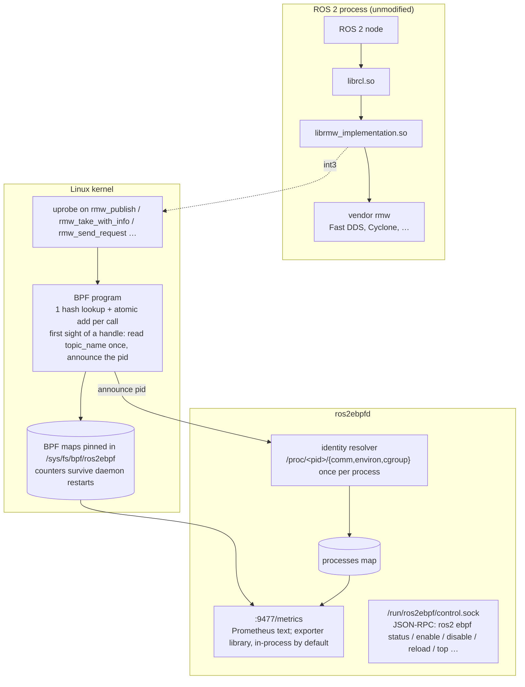

# ros2ebpf

**ROS 2 full observability statistics empowered by eBPF.**

`ros2ebpf` gives you publish / take / service-call rates, drop indicators and per-process identity for every ROS 2 process on a host, **without touching, rebuilding or restarting the nodes**.
A small daemon (`ros2ebpfd`) attaches eBPF uprobes to the shipped `librmw_implementation.so`, aggregates in kernel maps, and serves Prometheus metrics.
It runs on demand: `ros2 ebpf start` when you want to look at a robot, `ros2 ebpf stop` when you are done, the same way `ros2 daemon` is started by request.
Alert rules, Grafana dashboards and a Kubernetes DaemonSet for whole-cluster statistics are included.

```
ros2_rmw_publish_total{host="main",robot="amr-07",domain_id="5",comm="talker",topic="/chatter"} 1181
ros2_rmw_take_total{host="perception",robot="amr-07",domain_id="5",comm="listener",topic="/chatter"} 1180
ros2_rmw_service_request_total{host="main",robot="amr-07",domain_id="5",comm="add_two_ints_se",service="/add_two_ints",side="server"} 212
ros2_process_info{host="main",robot="amr-07",comm="talker",pid="4211",domain_id="5",rmw="rmw_fastrtps_cpp",container="",localhost_only="false"} 1
```

- Works against ROS 2 Rolling, binaries or a source build, any RMW, any client library.
- One daemon per Linux host; a robot is a set of hosts; a fleet is a set of robots.
- Nodes in containers are covered automatically (the daemon finds their shim through `/proc`).
- The daemon never computes a rate: counters are exported, Prometheus does the math.
- Design: [docs/design.md](docs/design.md).
  Metrics: [docs/metrics.md](docs/metrics.md).
  Multi-host / fleet: [docs/deployment.md](docs/deployment.md).

## Contents

- [ros2ebpf](#ros2ebpf)
  - [Contents](#contents)
  - [How it works](#how-it-works)
  - [Requirements](#requirements)
  - [Demo: talker, listener and a service](#demo-talker-listener-and-a-service)
    - [Start the container](#start-the-container)
    - [Build](#build)
    - [Configure](#configure)
    - [Start the daemon](#start-the-daemon)
    - [Run the demo nodes](#run-the-demo-nodes)
    - [Prometheus and Grafana](#prometheus-and-grafana)
    - [Stop and clean up](#stop-and-clean-up)
  - [Documentation](#documentation)
  - [Limitations](#limitations)

## How it works



Every `rmw_*` entry point receives a public handle whose first fields are `{implementation_identifier, data, topic_name|service_name}`.
The probe reads the name once per handle, keys counters by `(pid, handle)`, and the exporter joins them with per-process identity (`comm`, `domain_id`, container) at scrape time.
Per-robot identity (`robot=`) is added by the collector (Grafana Alloy / Prometheus agent) on `remote_write`.
Counters live with the endpoint: a destroyed publisher's series disappears, and the server side of a one-shot client is the durable record of the call.
The daemon runs on request, not permanently: while it runs every probed `rmw_*` call pays the BPF program (the cost model is in [docs/design.md](docs/design.md#10-cost-model)), so it is started when statistics are wanted and stopped when they are not.

Components:

| Component | Package | Form |
|---|---|---|
| `ros2ebpfd` daemon + `ros2ebpf-ctl` | `ros2ebpf_daemon` | C, libbpf CO-RE; no ROS dependency; started on demand by the CLI, or a container (Kubernetes DaemonSet) |
| exporter library + `ros2ebpf-exporter` | `ros2ebpf_exporter` | C; the map → Prometheus transform; standalone binary for `exporter.mode: external` |
| `ros2 ebpf` CLI | `ros2ebpf` | Python `ros2cli` extension |
| control protocol | `ros2ebpf_interfaces` | JSON-RPC schema shared by CLI and daemon |
| Prometheus / Alertmanager / Grafana / Alloy | `deploy/` | upstream images, our config |

## Requirements

ros2ebpf follows **ROS 2 Rolling** only, which implies Ubuntu 26.04 for now.

| | Required | Check |
|---|---|---|
| Kernel | Linux ≥ 5.8 with BTF (`CONFIG_DEBUG_INFO_BTF`); the Ubuntu 26.04 stock kernel qualifies | `ls /sys/kernel/btf/vmlinux` |
| bpffs | mounted at `/sys/fs/bpf` (systemd does this) | `mount \| grep bpf` |
| Container runtime | Docker (or Podman) that can run a privileged container in the host pid namespace | `docker run --rm --privileged --pid host ubuntu:26.04 true` |
| Arch | x86_64 or aarch64 | |

`ros2ebpfd` needs root, or `CAP_BPF CAP_PERFMON CAP_SYS_PTRACE` (+`CAP_SYS_RESOURCE`); the containers below run privileged, and the daemon is root inside them.
ROS 2 lives inside the containers: the Rolling source build of the demo below (the ROS 2 application and ros2ebpf in one container, or in sibling containers in the host pid namespace, which is also what the Kubernetes DaemonSet does).
Nothing from ROS is installed on the host, and a shim of any other distro is refused by the daemon.
`ros2 ebpf doctor` prints all of this for the host it runs on.

## Demo: talker, listener and a service

Everything runs in containers on one host: a ROS 2 Rolling source build with the ros2ebpf packages, the demo nodes and the daemon in one container, Prometheus and Grafana in two more.
At the end a C++ talker (`demo_nodes_cpp`), a Python listener (`demo_nodes_py`) and an `add_two_ints` server / client pair are running, and their rates show up in `ros2 ebpf top`, in Prometheus and on a Grafana dashboard.
Nothing is installed on the host.

### Start the container

```bash
WS=~/ros2_ws        # any colcon workspace you like; the container sees it at the same path
mkdir -p $WS/src && git clone https://github.com/fujitatomoya/ros2ebpf.git $WS/src/ros2ebpf
docker run -it --name ros2ebpf-dev --privileged --pid host --network host \
  -v /sys/fs/bpf:/sys/fs/bpf -v /etc/machine-id:/etc/machine-id:ro \
  -v $WS:$WS -w $WS tomoyafujita/ros2dev:rolling bash
```

| Option | Why |
|---|---|
| `--privileged` | load the BPF programs and attach the uprobes (`CAP_BPF`, `CAP_PERFMON`, `CAP_SYS_PTRACE`); without it the daemon fails at `attach … Operation not permitted` |
| `--pid host` | the daemon counts the processes of its own pid namespace (the BPF programs report pids of that namespace, which the daemon resolves through `/proc`); with the host's, that is every process on the host and in other containers, and it is how the daemon finds their shims. Without it only the processes of the same container are counted |
| `--network host` | every container of this demo is on the host network: the daemon's `:9477` is `localhost` for Prometheus, Prometheus is `localhost` for Grafana, and DDS works between nodes in different containers |
| `-v /sys/fs/bpf:/sys/fs/bpf` | the pinned maps live on the host's bpffs, so counters survive the container |
| `-v /etc/machine-id` | the `machine_id` label; optional |
| `-v $WS:$WS -w $WS` | the workspace at the same path inside and outside the container, so paths in `/etc/ros2ebpf/config.yaml` and in logs are valid in both; every shell below starts in it |

`tomoyafujita/ros2dev:rolling` ([ros2_devenv_builder](https://github.com/fujitatomoya/ros2_devenv_builder)) is Ubuntu 26.04 with every build dependency of Rolling installed.

### Build

Inside the container:

```bash
apt update && apt install -y clang llvm libbpf-dev bpftool libelf-dev zlib1g-dev libyaml-dev libjson-c-dev pkg-config python3-yaml python3-colorama
vcs import --shallow --input https://raw.githubusercontent.com/ros2/ros2/rolling/ros2.repos src
colcon build --symlink-install
source install/setup.bash
ros2ebpfd --version
ros2 ebpf --help
```

### Configure

```bash
mkdir -p /etc/ros2ebpf
cp install/ros2ebpf_daemon/etc/ros2ebpf/config.example.yaml /etc/ros2ebpf/config.yaml
cp install/ros2ebpf_daemon/etc/ros2ebpf/expectations.example.yaml /etc/ros2ebpf/expectations.yaml
sed -i "s|/opt/ros/rolling/lib/librmw_implementation.so|$PWD/install/rmw_implementation/lib/librmw_implementation.so|" /etc/ros2ebpf/config.yaml
ros2ebpfd --check -c /etc/ros2ebpf/config.yaml      # config parses, shim exports the rmw_* symbols, BTF present
```

The one thing to edit is the shim path: the `librmw_implementation.so` of the source build.
Every other key has a working default; they are all described in [docs/configuration.md](docs/configuration.md).

### Start the daemon

```bash
ros2 ebpf start
ros2 ebpf status -v                   # Healthy=yes, Links 16/16
```

In the container everything is root.
What `ros2 ebpf start` does when you are not root (`sudo`, the `ros2ebpf` group) is in [docs/cli.md](docs/cli.md#start-and-privileges).
The daemon log is `~/.ros/log/ros2ebpfd.log`; expected lines:

```
I ros2ebpfd 0.1.0 starting: host=main machine_id=… distro=ubuntu-26.04 arch=x86_64 kernel=7.0.0-…
I shim <workspace>/install/rmw_implementation/lib/librmw_implementation.so: distro=rolling arch=x86_64 dev=… ino=… (config)
I probe family publish enabled: 2/2 links
I probe family take enabled: 2/2 links
I probe family services enabled: 6/6 links
I probe family udp_drops enabled
I metrics at http://0.0.0.0:9477/metrics
I control socket at /run/ros2ebpf/control.sock
I ready: 16/16 probe links attached, 1 shim(s), offset table rolling/x86_64
```

### Run the demo nodes

In a second shell of the container:

```bash
docker exec -it ros2ebpf-dev bash
source install/setup.bash
export ROS_DOMAIN_ID=5                # any domain; the daemon reads ROS_DOMAIN_ID per process
ros2 run demo_nodes_cpp talker > /tmp/talker.log 2>&1 &
ros2 run demo_nodes_py listener > /tmp/listener.log 2>&1 &
ros2 run demo_nodes_cpp add_two_ints_server > /tmp/server.log 2>&1 &
while true; do ros2 run demo_nodes_py add_two_ints_client; sleep 1; done > /tmp/client.log 2>&1 &
```

Back in the first shell:

```bash
ros2 ebpf top --once --interval 3
#  Target  Kind          Name           Domain  Comm             PIDs   Hz    Hz(2nd)  Gaps
#  local   subscription  /chatter       5       listener         12345  1.00  -        0
#  local   publisher     /chatter       5       talker           12344  1.00  -        -
#  local   service       /add_two_ints  5       add_two_ints_se  12346  0.67  0.67     -

curl -s localhost:9477/metrics | grep -E '^ros2_(rmw_publish_total|rmw_take_total|rmw_service_request_total|process_info)'
```

For a service row `Hz` is requests taken and `Hz(2nd)` is responses sent.
The client is a new process on every call and its endpoints are removed when it exits, so its own row comes and goes; the server side is the one to watch.
`ros2 ebpf monitor` is the same view full-screen and refreshing, without Prometheus or a browser.

Nodes that were already running before the daemon started are counted from their next call: the uprobe lives on the library's inode, not on a process.

### Prometheus and Grafana

Two more containers on the host network, started on the host from the repository checkout, with the configuration, rules and dashboards from `deploy/`:

```bash
cd $WS/src/ros2ebpf
docker run -d --name prometheus --network host -v "$PWD/deploy/prometheus:/etc/prometheus:ro" \
  prom/prometheus:v3.5.0 --config.file=/etc/prometheus/prometheus-local.yml

docker run -d --name grafana --network host -e GF_SECURITY_ADMIN_PASSWORD=admin -e PROMETHEUS_URL=http://localhost:9090 \
  -v "$PWD/deploy/grafana/provisioning:/etc/grafana/provisioning:ro" \
  -v "$PWD/deploy/grafana/dashboards:/var/lib/grafana/dashboards:ro" grafana/grafana:12.1.0
```

[deploy/prometheus/prometheus-local.yml](deploy/prometheus/prometheus-local.yml) scrapes the daemon every 5 s at `localhost:9477` with the label `robot="bench-01"` and loads the alert rules of `deploy/prometheus/rules/ros2.yaml`.
The provisioned Grafana datasource takes Prometheus from `PROMETHEUS_URL`: `localhost:9090` here, the `prometheus` service in the central manifests.

Open them from any machine that reaches the host: `<host>` is the IP address or hostname of the machine running the containers, or `localhost` when the browser runs there too.
Both ports listen on every interface with no authentication beyond Grafana's `admin / admin`, so keep this on a trusted network.

- `http://<host>:9090/targets`: `ros2ebpf` is `UP`; query `rate(ros2_rmw_publish_total[1m])` while the talker runs.
- `http://<host>:3000` (admin / admin), Dashboards, folder **ROS 2**, **"ROS 2 demo"**: publish and take rate of `/chatter` per process, requests and responses of `/add_two_ints` per side, and the process table.
  The panels take 30 s to fill after the nodes start.

The other dashboards of the folder ("ROS 2 fleet", "ROS 2 robot", "ROS 2 host", "ros2ebpf daemon health") and the alert rules are for the multi-host layout of [docs/deployment.md](docs/deployment.md).

### Stop and clean up

```bash
kill %1 %2 %3 %4                      # second shell: the demo nodes
ros2 ebpf reset                       # forget the counters; without it the next `ros2 ebpf start` continues them
ros2 ebpf stop
docker rm -f prometheus grafana       # on the host
```

## Documentation

- [docs/configuration.md](docs/configuration.md): every key of `config.yaml`, `expectations.yaml` (expected rates per robot) and `fleet.yaml` (hosts per robot for the CLI).
- [docs/cli.md](docs/cli.md): every `ros2 ebpf` verb, `ros2ebpf-ctl` for hosts without ROS, and day-2 operations (reconfigure, reload, reset counters).
- [docs/metrics.md](docs/metrics.md): every series and label, with example queries.
- [docs/deployment.md](docs/deployment.md): a robot made of several hosts, a fleet of robots, the collector, the central Prometheus / Alertmanager / Grafana, Kubernetes.
- [docs/troubleshooting.md](docs/troubleshooting.md): symptoms and fixes.
- [docs/design.md](docs/design.md): the design and the rationale behind each decision.
- [docs/development.md](docs/development.md) and [docs/testing.md](docs/testing.md): code layout, adding probes, struct offsets, CI, unit and end-to-end tests.

Everything CI does, unattended, in the image of the demo (privileged for the BPF programs, host pid namespace for the daemon):

```bash
docker run --rm --privileged --pid host -v "$PWD":/src:ro -w /src tomoyafujita/ros2dev:rolling ./scripts/github_workflows.sh
```

## Limitations

- Intra-process publishes (all subscribers in the same process) bypass `rmw_publish` and are not counted.
- Sequence-gap tracking needs an RMW that fills `publication_sequence_number` (Fast DDS, Connext) and is exact only for single-publisher topics.

The full list, with the phase-2 plans and the cost model: [docs/design.md](docs/design.md#11-known-limitations--phase-2).

License: Apache-2.0.
