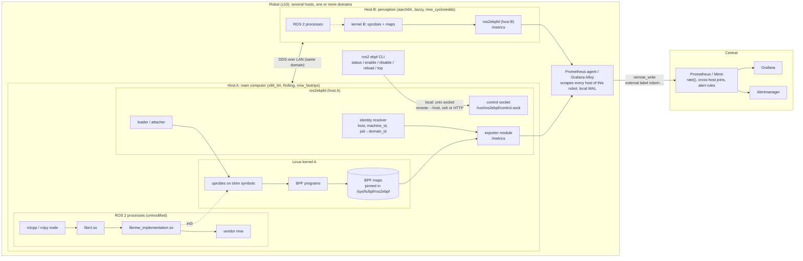
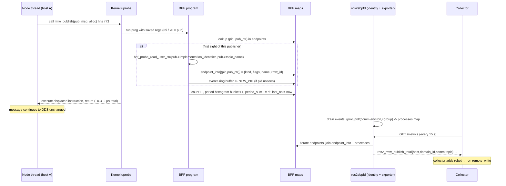

# ros2ebpf — Always-on ROS 2 endpoint statistics via eBPF

Design note, rev. 4 — 2026-11-04.

- rev. 1 (2026-10-07): initial design.
- rev. 2 (2026-11-04): multi-host / multi-robot identity (`host`, `machine_id`, `robot`, `domain_id`).
- rev. 3 (2026-11-04): restructured around the project's components — `ros2 ebpf` CLI, `ros2ebpfd`
  daemon, statistics exporter (placement decided in §5), Prometheus / Alertmanager — with repository
  layout, interfaces between components, and deployment procedures for Docker Compose and Kubernetes.
- rev. 4 (2026-11-04): implementation notes (§13) recording where the first implementation deviates
  from or refines rev. 3, after the end-to-end run against ROS 2 Jazzy nodes in a container.

## 1. Motivation

- `rclcpp` topic statistics is being removed from mainline (ros2/rclcpp#3203, with companion removals
  of `libstatistics_collector` and the demo). The ROSCon decision was to remove it entirely and rely
  on tooling that hooks into tracepoints.
- Tracing (ros2_tracing / LTTng) and statistics are different problems:
  - Tracing records every event into a ring buffer; a consumer chain
    (`lttng-consumerd` → CTF → babeltrace → analysis) is required before a number exists. Every
    stage scales with event rate. Good for post-hoc analysis, wrong shape for always-on metrics.
  - Statistics need aggregation at the hook and a tiny, bounded export. This is exactly the eBPF
    model: the probe program aggregates into BPF maps in kernel context, and user space only reads
    the maps at scrape time.
- Operators need to detect, with Prometheus + Alertmanager:
  - publish / take / service call frequency per endpoint, per host, per robot
  - message drops, where they are observable, including loss between hosts of one robot
  - without changing or restarting application code, against shipped Debian binaries.
- ROS 2 is distributed. A robot is usually several Linux hosts, a fleet may share a domain ID, and an
  eBPF probe only sees the kernel it is loaded into. Any metric that cannot say which machine it came
  from is ambiguous as soon as there is more than one.

## 2. Requirements

| # | Requirement | Notes |
|---|-------------|-------|
| R1 | Publish frequency per topic per process | counter + inter-publish-interval histogram |
| R2 | Take frequency per subscription | counter |
| R3 | Service request/response frequency | `rmw_send_request`, `rmw_send_response` |
| R4 | Drop detection | sequence-number gaps on take; kernel UDP socket drops; cross-host publish/take imbalance |
| R5 | No node code changes, no restarts, no DDS participant in the agent | attach to `librmw_implementation.so` |
| R6 | Fleet-scale (10+ robots, several hosts each), survives intermittent links | per-robot collector + `remote_write` |
| R7 | Expected rates expressed as data, one generic alert rule | `ros2_topic_expected_hz` keyed by robot + topic |
| R8 | Agent health is itself observable | probes attached, map occupancy, read failures |
| R9 | Every series carries host, robot and domain identity | `host` + `machine_id` from the OS, `robot` from operator config, `domain_id` per process |
| R10 | Hosts of one robot may differ in distro, RMW vendor and CPU architecture | per-(distro, arch) offset table; identity exported, not assumed |
| R11 | Operable through `ros2cli` like any other ROS 2 tool | `ros2 ebpf <verb>` |
| R12 | Reference deployment that a user can bring up end to end | Docker Compose for a bench, Kubernetes manifests for fleet / central |

## 3. Components and architecture

The project has four components. Two are built here, one is a thin layer whose placement is decided in
§5, and one is upstream software used as-is with a documented setup.

| Component | What it is | Runs where | Language / form |
|---|---|---|---|
| **`ros2 ebpf` CLI** (`ros2ebpf` package) | `ros2cli` verb extension; controls and queries the daemon | operator shell, any host of the robot | Python, `ros2cli` entry point |
| **`ros2ebpfd` daemon** (`ros2ebpf_daemon`) | probe core: loads BPF programs, attaches uprobes/tracepoints, owns maps, resolves identity | one per Linux host, as a systemd unit or container | C (libbpf, CO-RE) + BPF C |
| **Statistics exporter** (`ros2ebpf_exporter`) | turns BPF map contents into Prometheus exposition (and other formats later) | in-process inside `ros2ebpfd` by default; separable (§5) | C library + optional standalone binary |
| **Prometheus / Alertmanager / Grafana** | storage, rate computation, alerting, dashboards | per-robot collector + central server | upstream, unmodified; config and manifests in `deploy/` |

Deployment unit: **host**. Aggregation unit: **robot**. Correlation scope: **(robot, domain_id)**.



### 3.1 Repository layout

```
ros2ebpf/
├── ros2ebpf/                  # ros2cli verb extension (Python, ament_python)
│   ├── ros2ebpf/verb/         # status, enable, disable, reload, top, config, expectations, doctor, metrics
│   ├── ros2ebpf/api/          # control-protocol client: unix socket, ssh, http; fleet.yaml; rate computation
│   └── setup.py               # entry_points: ros2cli.command -> "ebpf"
├── ros2ebpf_daemon/           # ros2ebpfd (C, libbpf, CMake; no ROS dependency)
│   ├── bpf/                   # BPF C programs: rmw_probes.bpf.c, udp_drops.bpf.c, vmlinux_min.h
│   ├── src/                   # loader (probes.c), identity, control socket, config, offsets, main, ros2ebpf-ctl
│   ├── offsets/               # per-(distro, arch) struct offset table tooling (gen.sh)
│   ├── config/                # config.example.yaml, expectations.example.yaml
│   └── systemd/ros2ebpfd.service
├── ros2ebpf_exporter/         # map reader + Prometheus exposition (C library + ros2ebpf-exporter binary)
│   └── include/ros2ebpf/maps.h   # THE map contract shared by BPF, daemon and exporter
├── ros2ebpf_interfaces/       # control protocol (JSON-RPC over unix socket) schema + docs
├── deploy/
│   ├── docker-compose/        # bench: daemon + Alloy + Prometheus + Alertmanager + Grafana on one box
│   ├── k8s/                   # DaemonSet for ros2ebpfd + Alloy; central Prometheus/Alertmanager/Grafana manifests
│   ├── prometheus/            # rules/ros2.yaml, alertmanager.yml, prometheus.yml
│   └── grafana/               # provisioning + dashboards: fleet, robot, host, daemon health
├── docker/                    # Dockerfile.{daemon,cli,demo}
├── scripts/github_workflows.sh  # CI: rolling source build, tests, end-to-end
└── docs/
```

`ros2ebpf_daemon` and `ros2ebpf_exporter` have no dependency on a ROS 2 installation: they are plain
Debian packages (`ros2ebpf-daemon`, `ros2ebpf-exporter`) that can be installed on a host with only the
shipped ROS binaries. `ros2ebpf` (CLI) is a normal ROS 2 package released through the buildfarm.

### 3.2 Interfaces between components

| From → To | Interface | Notes |
|---|---|---|
| CLI → daemon | JSON-RPC over unix socket `/run/ros2ebpf/control.sock` | group `ros2ebpf`, mode 0660; verbs map 1:1 to RPC methods |
| CLI → remote daemon | same protocol over `ssh <host> ros2ebpf-ctl rpc` or optional HTTP on `:9478` | `--host` / `--robot` flags; no DDS involved |
| daemon → kernel | libbpf: `bpf_program__attach_uprobe_opts`, `tp_btf` tracepoints, pinned maps | maps under `/sys/fs/bpf/ros2ebpf/` |
| daemon → exporter | pinned BPF maps + pinned `processes` identity map | the only contract the exporter depends on; allows out-of-process exporter |
| exporter → collector | Prometheus text exposition on `:9477/metrics` | `host` label on every series |
| collector → central | `remote_write` with `robot` external label | WAL buffers link loss |
| central → operator | Alertmanager receivers, Grafana | rules in `deploy/prometheus/rules/ros2.yaml` |

## 4. `ros2ebpfd` daemon (probe core)

### 4.1 Responsibilities

- Not a ROS node: no rclpy, no DDS participant, no sourced workspace at runtime.
- Inputs: zero or more shim paths (`librmw_implementation.so`), a per-(distro, arch) struct offset
  table, `/etc/ros2ebpf/config.yaml`.
- **Attach**: resolves symbols to inode+offset (PID-independent, so processes started later are
  covered), verifies that the ELF exports the expected `rmw_*` symbols, and attaches `rmw_*`
  uprobes/uretprobes, `rmw_destroy_*` cleanup probes, `sched_process_exit`, and the UDP drop
  tracepoint. Shims used by containers are discovered through `/proc/<pid>/maps` (§13).
- **Maps**: pinned under `/sys/fs/bpf/ros2ebpf/` so counters survive daemon restarts and so a
  separate reader can open them.
- **Identity** (§4.3): host-level facts once at start, per-process facts once per PID.
- **Control**: unix-socket RPC for the CLI; SIGHUP reloads config (filters, expectations) without
  detaching; enabling/disabling a probe family at runtime attaches/detaches links, maps stay.
- **Export**: runs the exporter module in-process by default (§5).
- Idle between scrapes; no polling of maps.

### 4.2 Why the rmw shim

`librcl.so` links to `librmw_implementation.so`, which exports every `rmw_*` symbol and forwards to
the loaded vendor library. One probe per symbol therefore covers all RMW implementations and all
client libraries (rclcpp, rclpy, rclrs). The first argument of each call is a public `rmw/types.h`
struct carrying the name:

| Symbol | arg0 type | name field |
|--------|-----------|------------|
| `rmw_publish`, `rmw_publish_loaned_message` | `rmw_publisher_t *` | `topic_name` (offset 16 on LP64: x86_64 and aarch64) |
| `rmw_take_with_info` (uretprobe) | `rmw_subscription_t *` | `topic_name` (offset 16) |
| `rmw_send_request`, `rmw_take_response` | `rmw_client_t *` | `service_name` |
| `rmw_take_request`, `rmw_send_response` | `rmw_service_t *` | `service_name` |
| `rmw_destroy_publisher` / `rmw_destroy_subscription` / ... | handle is **arg1** (arg0 is the node) | cleanup |

Offsets are ABI, verified per (distro, arch) at build (`offsets/gen.sh`) and at runtime (the probe also
reads `implementation_identifier` from offset 0 of every handle; a value not starting with `rmw_`
is reported as `ros2ebpf_unknown_rmw_processes`). Mixed fleets are the norm, so the table is keyed
by both and the daemon exports which entry it used.

### 4.3 Host, robot and domain identity

| Label | Meaning | Source | Set by |
|---|---|---|---|
| `host` | which kernel the probe ran in | `/proc/sys/kernel/hostname` (config / `ROS2EBPF_HOST` override) | daemon, on every series |
| `machine_id` | stable identity across renames / reimages | `/etc/machine-id` | daemon, in `ros2ebpf_host_info` only |
| `robot` | the physical unit operators reason about | operator config | collector `remote_write` external label (fallback: `robot:` in daemon config) |
| `domain_id` | the ROS 2 graph the process is part of | per process | daemon, on every endpoint series |

Per-process facts are resolved once per PID (the BPF program pushes unseen PIDs to a ring buffer, the
daemon reads `/proc/<pid>/{comm,environ,cgroup,stat}` off the hot path) and dropped on
`sched_process_exit`: `comm`, `domain_id` (`ROS_DOMAIN_ID`, default `0`, `unknown` if `environ` is
unreadable), `rmw` (`RMW_IMPLEMENTATION`, or the shim's identifier read by the probe),
`localhost_only`, `container` (from the cgroup path). Reading `environ` needs `PTRACE_MODE_READ`,
hence `CAP_SYS_PTRACE` in the unit file. Containerised nodes have their shim resolved through
`/proc/<pid>/root`. Every host keeps its own monotonic clock; cross-host correlation is done on
rates over the same window, never on timestamps.

### 4.4 Data flow for one `rmw_publish`



Key properties: the name read happens once per publisher, the `/proc` read once per PID; counters
are updated with atomic adds; `rmw_destroy_*` deletes keys in the probe and `sched_process_exit`
triggers a user-space sweep; topic filters are applied in the BPF program (hashed exclude list,
evaluated at first sight and stored as a flag) so excluded topics cost one hash lookup and nothing
more.

## 5. Statistics exporter: placement decision

The question is whether "turn maps into Prometheus text" is part of the daemon or a separate
component. Considerations:

| | In-process (exporter module linked into `ros2ebpfd`) | Separate process (`ros2ebpf-exporter` reading pinned maps) |
|---|---|---|
| Privileges | one privileged process | reader still needs `CAP_BPF` to open pinned maps (or bpffs ACLs); little privilege is actually shed |
| Identity join | pid table is in daemon memory, trivially available | must be pinned as a BPF map too, or served over IPC |
| Failure modes | exporter bug can take the probe core down | daemon keeps counting while exporter restarts |
| Multiple formats / sinks | Prometheus only, or compile-time options | Prometheus, OTLP push, ROS 2 topic (`/ros2ebpf/statistics`) each as their own reader |
| Operational surface | one unit, one port, one config | two units to keep in sync; CLI `status` must check both |
| Scrape cost | reads maps directly | same, through the pinned fds |

**Decision.** The exporter is a **library with a stable input contract** (the pinned map layout in
`ros2ebpf/maps.h` plus the pinned `processes` map), shipped as its own package `ros2ebpf_exporter`,
and the daemon **links it in and serves `/metrics` itself by default**. Reasons:

1. A separate process does not actually reduce privilege: opening a pinned map needs `CAP_BPF`.
2. One privileged process is what operators have to reason about on 30+ hosts; two is worse.
3. The identity join is cheap in-process and awkward over IPC.

What the split still buys is kept by making the contract explicit: the daemon pins the identity table
as a BPF map alongside the counters, so `ros2ebpf-exporter` can also run standalone
(`exporter: {mode: external}` in config disables the in-process HTTP server) for cases that need it:
an OTLP or ROS-topic sink, a hardened host where the HTTP listener must run as a different user, or
debugging the daemon without a collector. The CLI's `status` reports which mode is active and whether
the exporter endpoint answers.

Implementation rule that follows: **the daemon never computes a rate**. Counters are monotonic, the
scrape interval sets the time resolution, `rate()` is server-side and re-windowable. The exporter is a
pure map-to-text transform; everything derived lives in Prometheus.

## 6. `ros2 ebpf` CLI

A `ros2cli` command extension (`ros2 ebpf`), installed like `ros2 topic` or `ros2 node`. It talks to
the daemon over the control socket and never to DDS, so it works even when no ROS process is running
and does not create a participant.

| Verb | Effect |
|---|---|
| `ros2 ebpf status [-v] [-q] [--host H \| --robot R]` | attached probes, map occupancy, exporter mode and health, resolved identity (host, machine_id, robot, domains seen), offset table in use |
| `ros2 ebpf enable <publish\|take\|services\|udp_drops>` / `disable` | attach/detach a probe family at runtime; counters are kept |
| `ros2 ebpf reload` | SIGHUP-equivalent: reread filters, expectations; no detach |
| `ros2 ebpf top [--topic T] [--domain D] [--kind K] [--once]` | live per-endpoint rates computed client-side from two map reads; for bench use only (the server does this in production) |
| `ros2 ebpf config show\|get\|set <key> <value>\|keys` | edit `/etc/ros2ebpf/config.yaml` with validation, then `reload` |
| `ros2 ebpf expectations capture --duration 60s [--takers]` | observe current rates and write `expectations.yaml` as a starting point |
| `ros2 ebpf doctor` | checks kernel version, BTF, bpffs, capabilities, shim symbols, daemon and exporter reachability; prints what would fail at attach |
| `ros2 ebpf metrics [--grep S]` | the exposition the daemon would serve, through the control socket |

`--robot R` fans out to every host listed under that robot in `/etc/ros2ebpf/fleet.yaml` and prints a
merged table. `--host` accepts ssh targets (`user@host`), `host:9478` (HTTP control) and
`unix:///path`. Output is tabular by default and `--format json` for scripting; `status` exit code is
non-zero when any probe family requested in config is not attached, so it can be used as a readiness
check (`ros2ebpf-ctl status -q` does the same without ROS, for container probes).

## 7. Metrics

Label contract: `robot` (collector) and `host` (daemon) on everything; `domain_id` and `comm` on all
endpoint series; `topic` / `service` fully expanded as seen by rmw; `rmw` optional (off by default,
cardinality). **No `pid` and no `machine_id` on counters**: both live in `_info` series and are
joined with `group_left`. Endpoints sharing a label set (two publishers of one topic in one process,
two processes with the same `comm`) are summed by the exporter.

| Metric | Type | Source |
|--------|------|--------|
| `ros2_rmw_publish_total` | counter | `rmw_publish`, `rmw_publish_loaned_message` |
| `ros2_rmw_publish_period_seconds` | histogram | inter-publish interval |
| `ros2_rmw_take_total` | counter | `rmw_take_with_info` with `taken == true` |
| `ros2_rmw_take_seq_gap_total`, `ros2_rmw_take_seq_lost_total` | counter | gaps in `rmw_message_info_t::publication_sequence_number` (where the RMW fills it) |
| `ros2_rmw_service_request_total{side}` / `_response_total{side}` | counter | `side=client`: `rmw_send_request` / `rmw_take_response`; `side=server`: `rmw_take_request` / `rmw_send_response` |
| `ros2_udp_rcvbuf_drop_total{port,comm}` | counter | `tp_btf/udp_fail_queue_rcv_skb`, keyed by local port |
| `ros2_topic_expected_hz{topic}` | gauge | from `expectations.yaml`; no `host` |
| `ros2_topic_expected_takers{topic}` | gauge | optional: hosts expected to take the topic |
| `ros2_process_info{comm,pid,domain_id,rmw,container,localhost_only}` | gauge (=1) | per process |
| `ros2ebpf_host_info{host,machine_id,distro,arch,kernel,shim_path,offset_table,exporter_mode}` | gauge (=1) | per host |
| `ros2ebpf_probes_attached`, `ros2ebpf_probes_configured`, `ros2ebpf_map_entries{map}`, `ros2ebpf_name_read_failures_total`, `ros2ebpf_id_read_failures_total`, `ros2ebpf_events_dropped_total`, `ros2ebpf_map_full_total`, `ros2ebpf_environ_read_failures_total`, `ros2ebpf_identity_resolve_failures_total`, `ros2ebpf_unknown_rmw_processes`, `ros2ebpf_unresolved_endpoints`, `ros2ebpf_unnamed_endpoints`, `ros2ebpf_scrape_duration_seconds`, `ros2ebpf_map_abi`, `ros2ebpf_build_info` | gauge/counter | daemon + exporter self-health |

See `docs/metrics.md` for the full reference with PromQL examples.

## 8. Configuration

### 8.1 Daemon (per host)

```yaml
# /etc/ros2ebpf/config.yaml
host: ""                      # empty = kernel hostname
robot: ""                     # optional fallback; normally set by the collector's external label
shims:
  - distro: rolling
    arch: x86_64
    path: /opt/ros/rolling/lib/librmw_implementation.so
discover_shims: true          # also find shims used by containers through /proc/<pid>/maps
identity:
  read_environ: true          # needs CAP_SYS_PTRACE; otherwise domain_id="unknown"
  default_domain_id: 0
probes:
  publish: true
  take: true
  services: true
  seq_gap: [/lidar/points, /camera/image_raw]   # uretprobe seq tracking only here (or `all`)
  udp_drops: true
topics:
  exclude: [/parameter_events, /rosout]
histogram_buckets_seconds: [0.0005, 0.001, 0.002, 0.005, 0.01, 0.02, 0.05, 0.1, 0.5, 1]
exporter:
  mode: inprocess             # inprocess | external
  listen: 0.0.0.0:9477
  rmw_label: false
control:
  socket: /run/ros2ebpf/control.sock
  http: ""                    # e.g. 0.0.0.0:9478 to allow remote `ros2 ebpf` without ssh
expectations_file: /etc/ros2ebpf/expectations.yaml
pin_root: /sys/fs/bpf/ros2ebpf
log_level: info
```

```yaml
# /etc/ros2ebpf/expectations.yaml  (per robot: a property of the robot, not the host;
# served by one host, typically the one running the collector)
/lidar/points: 10
/odom: 50
/imu/data: {hz: 200, takers: 1}
```

### 8.2 Collector (per robot)

```yaml
# Grafana Alloy / prometheus agent on the robot's main computer (prometheus syntax shown)
scrape_configs:
  - job_name: ros2ebpf
    honor_labels: true
    static_configs:
      - targets: [main:9477, perception:9477, arm-controller:9477]
    # `host` comes from the exporter; do not relabel `instance` into `host`
remote_write:
  - url: https://central/api/v1/write
    external_labels:
      robot: amr-07
      site: osaka-dc1
```

### 8.3 Alert rules (fleet-wide)

Shipped as `deploy/prometheus/rules/ros2.yaml`; loaded by the central Prometheus. The core rules:

```yaml
groups:
  - name: ros2ebpf
    rules:
      - alert: Ros2TopicRateLow
        expr: |
          sum by (robot, domain_id, topic) (rate(ros2_rmw_publish_total[30s]))
            < on (robot, topic) group_left () (0.8 * ros2_topic_expected_hz)
        for: 1m
        labels: {severity: warning}
      - alert: Ros2CrossHostLoss
        expr: |
          sum by (robot, domain_id, topic) (rate(ros2_rmw_take_total[1m]))
            < on (robot, domain_id, topic)
              (0.9 * sum by (robot, domain_id, topic) (rate(ros2_rmw_publish_total[1m]))
                 * on (robot, topic) group_left () ros2_topic_expected_takers)
        for: 2m
        labels: {severity: warning}
      - alert: Ros2SeqGaps
        expr: increase(ros2_rmw_take_seq_gap_total[5m]) > 0
        labels: {severity: info}
      - alert: Ros2ebpfHostDown
        expr: up{job="ros2ebpf"} == 0
        for: 2m
        labels: {severity: critical}
      - alert: Ros2ebpfRobotBlind
        expr: absent(up{job="ros2ebpf"})
        for: 5m
        labels: {severity: critical}
      - alert: Ros2ebpfProbesMissing
        expr: ros2ebpf_probes_attached < ros2ebpf_probes_configured
        for: 1m
        labels: {severity: critical}
      - alert: Ros2DomainShared
        expr: |
          count by (domain_id, topic) (group by (robot, domain_id, topic) (ros2_rmw_publish_total)) > 1
        for: 10m
        labels: {severity: info}
```

## 9. Deployment

Two reference deployments live in `deploy/`. Both use upstream images for Prometheus, Alertmanager,
Grafana and Alloy without modification; only configuration is ours. The full procedures, including
the multi-host robot setup, are in `README.md` and `docs/deployment.md`.

### 9.1 Requirements on every probed host

- Linux ≥ 5.8 (`CAP_BPF`, ring buffer), BTF available (`/sys/kernel/btf/vmlinux`) for CO-RE and
  `tp_btf` tracepoints; the `ros2 ebpf doctor` verb checks this.
- bpffs mounted at `/sys/fs/bpf`.
- ROS 2 binaries installed from Debian packages (the offset table is keyed on the distro's shipped
  `librmw_implementation.so`; a from-source build needs its own row, generated with
  `ros2ebpf_daemon/offsets/gen.sh`).
- Capabilities for `ros2ebpfd`: `CAP_BPF`, `CAP_PERFMON`, `CAP_SYS_PTRACE` (identity), and
  `CAP_SYS_RESOURCE` if the map memlock limit is raised. Running as root is the simple alternative;
  never as a ROS user.

### 9.2 Bare-metal / systemd (the normal case on a robot)

```
sudo apt install ros-rolling-ros2ebpf-daemon                     # build farm package once released; or a colcon build
sudo ros2 ebpf doctor                                             # kernel, bpffs, shim, offsets
sudo editor /etc/ros2ebpf/config.yaml                             # robot name, shims, probes
sudo systemctl enable --now ros2ebpfd
ros2 ebpf status
curl -s localhost:9477/metrics | grep ros2_rmw_publish_total | head
```

The unit file sets `AmbientCapabilities=CAP_BPF CAP_PERFMON CAP_SYS_PTRACE CAP_SYS_RESOURCE`,
`ProtectSystem=strict`, `ReadWritePaths=/sys/fs/bpf /run/ros2ebpf`, and `Restart=on-failure`. Pinned
maps survive restarts, so counters do not reset on upgrade.

### 9.3 Docker Compose (bench: everything on one machine)

`deploy/docker-compose/compose.yaml` brings up one probed host plus the full pipeline, for trying the
system against a locally running ROS 2 workspace or demo nodes (`--profile demo`). The daemon
container runs with `pid: host` and `privileged: true` (or the explicit capability list), mounts
`/sys/fs/bpf` and `/sys/kernel/btf`, and shares `/run/ros2ebpf` with the CLI container.

### 9.4 Kubernetes

`deploy/k8s/robot/`: a DaemonSet runs one `ros2ebpfd` per node (`hostPID`, `hostNetwork`), a per-robot
Alloy Deployment scrapes them through `kubernetes_sd` and `remote_write`s to central.
`deploy/k8s/central/`: plain kustomize manifests (Prometheus StatefulSet with remote-write receiver,
Alertmanager, Grafana) or values for `kube-prometheus-stack`.

### 9.5 Verifying an installation

1. `ros2 ebpf status` on each host: all configured probe families attached, offset table matches
   the distro, exporter mode `inprocess`, identity shows the expected `robot`.
2. `curl host:9477/metrics`: `ros2ebpf_host_info` present with correct `machine_id`;
   `ros2_process_info` lists the running nodes with non-`unknown` `domain_id`.
3. Central Prometheus: `up{job="ros2ebpf"}` is 1 for every host of every robot; the
   `Ros2ebpfProbesMissing` and `Ros2ebpfHostDown` alerts are inactive.
4. Grafana "ROS 2 fleet" dashboard shows publish rates per `(robot, host, topic)`; stop one talker
   and watch `Ros2TopicRateLow` fire for that robot within ~90 s.

## 10. Cost model

| | LTTng-UST | uprobe + BPF |
|---|---|---|
| per hit, enabled | ~0.1–0.3 µs, no kernel entry | ~0.3–2 µs, trap into kernel |
| disabled | one branch | nothing (instruction untouched) |
| aggregation | none; stream + post-process | in-kernel maps |
| always-on cost | event rate × consumer + I/O | event rate only, bounded |
| per-PID identity | n/a | one `/proc` read per process lifetime, off hot path |

At typical ROS rates (≤ 1 kHz per publisher) the probe cost is < 0.2 % of the period. For very
high-rate publishers, sample in the BPF program or count only at the subscription. Cost is per host
and does not grow with the number of hosts on the domain; series count does (hosts × processes ×
endpoints), controlled by `exclude` and the optional `rmw` label.

## 11. Known limitations / phase 2

1. **Intra-process comms**: `rmw_publish` is skipped when all subscribers are in-process. Needs the
   `rclcpp_intra_publish` tracepoint plus handle→name mapping from `rcl_publisher_init`, which
   requires the daemon to be running before the nodes start. Same mechanism gives node names as a
   label and the domain ID for processes that set it through init options.
2. **DDS-internal drops** (reliable reader history overflow) are invisible outside the vendor
   library; only `RMW_EVENT_MESSAGE_LOST` sees them, and only if the application created the event.
   Sequence gaps on take are the proxy.
3. **Sequence numbers** depend on the RMW populating `publication_sequence_number` (Fast DDS and
   Connext do; verify others), and the per-subscription tracker is exact only for single-publisher
   topics (two publishers interleave their sequences). In a mixed-vendor robot seq-gap coverage
   differs per host; `ros2_process_info{rmw}` says where it applies.
4. **Cross-host loss is a rate inequality, not a count**: no shared clock, so no per-message
   matching across hosts; the rules compare rates over the same window and need an expected taker
   count to be exact.
5. **Domain ID coverage**: resolved from the environment only (phase 2: `rcl_init`); unreadable
   processes report `unknown`.
6. **Mixed architectures**: x86_64 and aarch64 covered (LP64, arg0 in `rdi` / `x0`); the BPF object
   is built per arch and offsets verified per (distro, arch).
7. **Exporter sinks**: Prometheus text only in phase 1; OTLP push and a ROS topic sink are the
   motivating cases for the external exporter mode.
8. Linux-only; `CAP_BPF` + `CAP_PERFMON` (+ `CAP_SYS_PTRACE` for identity); containerised nodes
   need the shim resolved through `/proc/<pid>/root`.
9. Offsets are ABI, not API; the per-(distro, arch) table and the runtime identifier check are the
   mitigation until a stable hook exists.
10. **Short-lived endpoints**: counters live with the endpoint. A client that is created, used once
    and destroyed (e.g. a one-shot `add_two_ints_client`) leaves no series behind; the server side
    of the same call is the durable record.

## 12. Implications for ROS 2 mainline

- The removal rationale ("tracepoint tooling covers it") holds for publish/take only if the
  tracepoints are consumable by something other than LTTng. Confirm whether the shipped
  `liblttng-ust` carries SDT notes (`readelf -n libtracetools.so | grep stapsdt`) so the
  ros2_tracing points double as USDT probes; otherwise uprobes on the `ros_trace_*` symbols.
- Items 1–2 and 5 above are the argument for a small, stable, client-library-independent hook in
  mainline: an `rcl`-level emission API (or an opt-in counter in the `rmw_implementation` shim)
  covering intra-process publishes, QoS events (`MESSAGE_LOST`, deadline missed) and the resolved
  domain ID / node name, which no out-of-process observer can reach today.
- Cross-host observability would be simpler if `rmw_message_info_t` guaranteed
  `publication_sequence_number` across vendors; today it is the only portable link between a
  publisher on one host and a taker on another.
- Everything in §4–§9 works against current Debian binaries without upstream changes.

## 13. Implementation notes (rev. 4)

Decisions taken while building the first version, where they refine rev. 3:

| Topic | rev. 3 said | Implemented | Why |
|---|---|---|---|
| Hot counters | `PERCPU_HASH` | one `HASH` per endpoint, atomic adds (`__sync_fetch_and_add`) | the interval histogram needs `last_ns` shared across CPUs anyway; at ROS rates the atomic is negligible and the exporter stays trivial |
| Tracepoints | `tracepoint/...` | `tp_btf/sched_process_exit`, `tp_btf/udp_fail_queue_rcv_skb` | plain tracepoints need tracefs, which containers do not have; `tp_btf` needs only BTF, and hands over `struct sock *` so the UDP probe works on kernels before and after the 6.11 tracepoint signature change |
| Shims | static list per host | static list **plus discovery**: `/proc/<pid>/maps` is scanned every 5 s for `librmw_implementation.so`, keyed by the mapped file's `dev:inode` (the real inode even through overlayfs), attached via `/proc/<pid>/root/<path>` | a daemon on the host (or in a `pid: host` container) then covers ROS processes in any container without configuration; verified against Jazzy nodes in a container |
| Pin layout | `/sys/fs/bpf/ros2ebpf/<shim-id>/` | one map set under `/sys/fs/bpf/ros2ebpf/`, `config.abi` field checked at start; incompatible pins are recreated | maps are keyed by `(pid, handle)` so one set serves every shim; a per-shim split would only complicate the exporter |
| Process exit | BPF deletes keys | BPF pushes `EXIT_PID` to the ring buffer; the daemon sweeps the maps in user space; a 30 s GC sweeps dead pids as a safety net | BPF cannot iterate a hash map by a key prefix; user space can, off the hot path |
| Service metrics | `_request_total` / `_response_total` | same names with a `side` label (`client` / `server`) | both ends of a call are observable (`rmw_send_request` + `rmw_take_request`), and the server side is the durable record for short-lived clients |
| UDP drops | `{comm}` | keyed by local port in BPF; `{port, comm}` where `comm` is resolved from `/proc/net/udp{,6}` + `/proc/<pid>/fd` of known ROS pids at scrape time | the tracepoint fires in softirq context where `current` is not the socket owner |
| Control client | ssh `-W` to the socket | `ros2ebpf-ctl` (C, no ROS) speaks the line protocol; the CLI runs `ssh <host> ros2ebpf-ctl rpc` | also serves as the container readiness probe and as a scripting tool on hosts without ROS |
| Filters | hashed allow-list | hashed `name_filter` map with per-name flags (`EXCLUDE`, `SEQ_GAP`) looked up once at first sight and copied into the stats entry; `reload` re-flags existing entries | one lookup on the cold path, zero on the hot path |
| Defaults | — | `topics.exclude` defaults to `/parameter_events` and `/rosout`; an explicit empty list clears it | matches the documented behaviour even with a minimal config |
